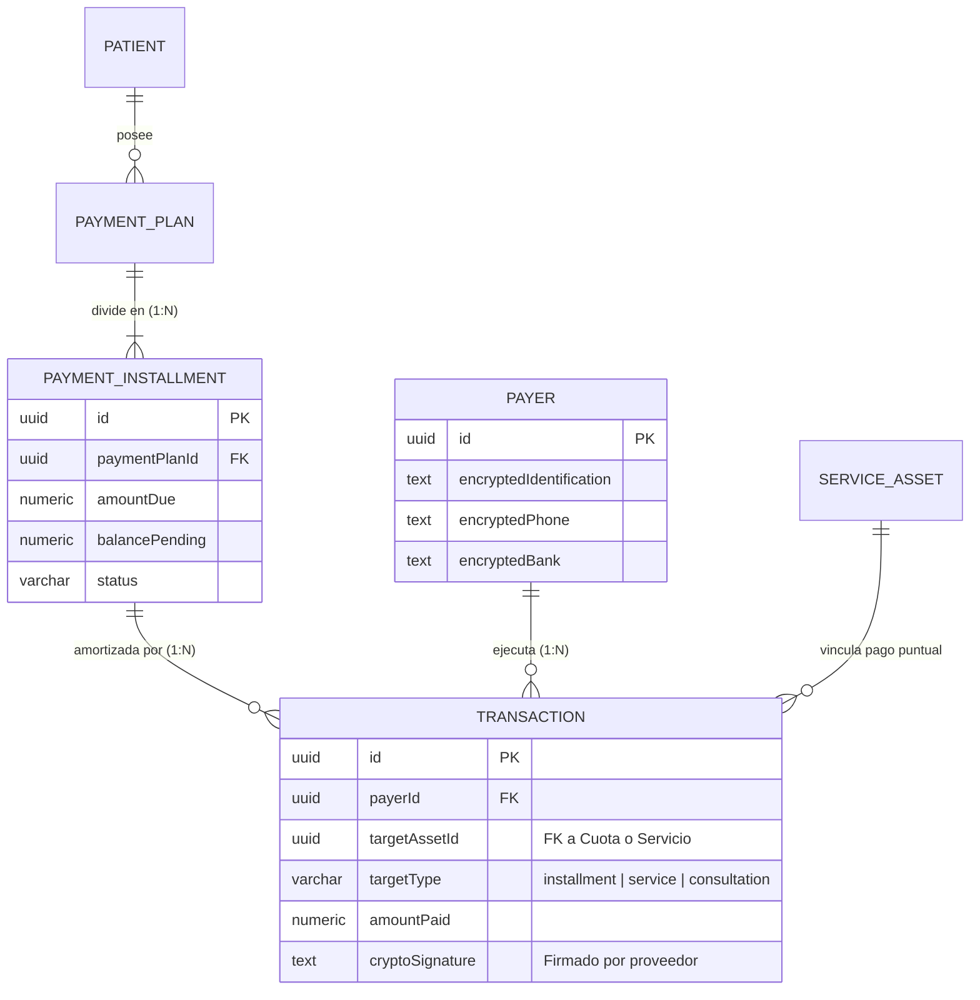
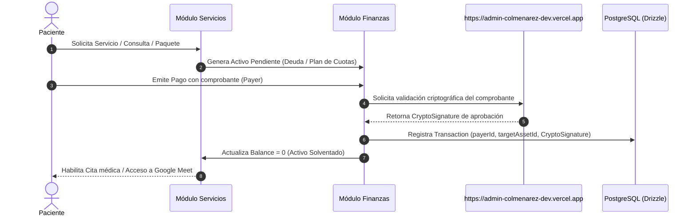

# Apartado 0001: Finanzas

Este documento detalla las especificaciones técnicas, reglas de negocio, esquema de base de datos y medidas de seguridad del módulo financiero de **CuerpoHermoso Web**. El objetivo central de este apartado es garantizar la trazabilidad contable, prevenir fraudes mediante verificación criptográfica centralizada, vincular estrictamente los cobros a activos o cuotas activas, y desacoplar la lógica financiera de la temporalidad de los servicios médicos.

---

## §1 Almacenamiento y Retención de Comprobantes (Decisión Finanzas D-0001)

Para mantener la integridad operativa y garantizar el cumplimiento normativo en materia de privacidad de datos, la gestión de comprobantes de pago digitales se rige por la **Decisión Finanzas D-0001**.

* **Almacenamiento en Blob Storage:** Todos los recibos, capturas de transferencias y soportes adjuntos son procesados y alojados mediante almacenamiento [Vercel Blob](https://vercel.com/docs/storage/vercel-blob).
* **Política de Retención (30 Días):** Los archivos digitales asociados a una transacción deben ser eliminados de manera permanente una vez transcurridos **30 días** posteriores a la fecha en la que la evaluación médica, sesión o servicio haya sido completado satisfactoriamente.

### §1.1 Servicio de Depuración Automática (`clearReceiptServicesRendered`)

Para automatizar este flujo, se integra un servicio en segundo plano (*worker* / *cron job*) encargado de auditar periódicamente los registros y limpiar el almacenamiento en Blob Storage.

```typescript
// src/lib/actions/clearReceiptServicesRendered.ts
import { db } from "@/src/db";
import { del } from "@vercel/blob";

export async function clearReceiptServicesRendered() {
  // 1. Consultar evaluaciones y servicios ejecutados con antigüedad > 30 días
  // 2. Eliminar referencias de archivos en Vercel Blob
  // 3. Actualizar estado del soporte documental en la base de datos
}
```

---

## §2 Verificación Criptográfica de Pagos y Seguridad Anti-Fraude (Decisión Finanzas D-0002)

### §2.1 Vulnerabilidad del Flag Booleano Convencional

Una verificación de pagos basada únicamente en una columna booleana (`validationCorrectly: boolean`) presenta una vulnerabilidad crítica: cualquier modificación directa o no autorizada sobre el registro en la tabla (vía base de datos, script o manipulación en capa de persistencia) permitiría cambiar el valor a `true`, lo cual generaría de forma inmediata un comprobante aparentemente legítimo y desbloquearía accesos a citas o tratamientos sin confirmación de fondos reales.

### §2.2 Verificación Criptográfica vía Proveedor Centralizado

Conforme a la **Decisión Finanzas D-0002**, se erradica el booleano simple como factor de validación definitiva y se establece un mecanismo de validación criptográfica gobernado por el proveedor centralizado oficial:

> **Proveedor de Verificación Externa:**  
> [https://admin-colmenarez-dev.vercel.app](https://admin-colmenarez-dev.vercel.app)

* **Firma Criptográfica / Hash de Validación:** Cada transacción verificada por el departamento de finanzas genera un token criptográfico firmado por `https://admin-colmenarez-dev.vercel.app`.
* **Inmutabilidad y Comprobantes Legítimos:** Para emitir un comprobante válido u otorgar accesos a servicios médicos, el sistema valida la firma criptográfica (`verificationSignature` / `cryptoProof`). La simple alteración del estado local en la base de datos no es suficiente si la firma no concuerda con la clave pública o hash del proveedor centralizado.
* **Integración API:** Las llamadas de conciliación y confirmación de pagos interactúan con las rutas de API autenticadas provistas por el dominio del administrador.

---

## §3 Vinculación Obligatoria a Activos y Modelo de Planes de Pago (Decisión Finanzas D-0004)

Un principio rector de la arquitectura financiera es que **ningún pago puede existir de forma aislada**. Cada transacción debe adherirse de manera obligatoria a un activo pendiente por pagar o a una obligación financiera preexistente.

### §3.1 Principio de Adherencia a Activos y Saldo Pendiente

* **Tipos de Activos Financieros Admisibles:**
  1. **`consulta-online`:** Cita o telemedicina virtual puntual.
  2. **`cuota` (Plan de Pago):** Abono parcial o cuota específica dentro de un plan de pagos estructurado.
  3. **`servicio puntual`:** Procedimiento médico, paquete estético, tratamiento ambulatorio o quirúrgico unitario.
* **Prohibición de Pagos Huérfanos:** Si no existe una relación válida y activa hacia un activo o servicio, **el pago no puede procesarse ni aceptarse**.
* **Bloqueo por Saldo Cubierto:** La plataforma no puede recibir ni procesar fondos si el cliente no posee un activo pendiente de pago, o si el saldo pendiente ya ha sido cubierto en su totalidad (saldo pendiente igual a 0).

### §3.2 Relación 1:N entre Plan de Pagos, Cuotas y Transacciones

Para tratamientos o paquetes de mayor envergadura, se implementa una arquitectura jerárquica:

1. **Plan de Pagos a Cuotas (1:N):** Un `PaymentPlan` se compone de una cantidad N de cuotas (`PaymentInstallment`). Cada cuota tiene un monto nominal asignado, fecha límite de corte y un identificador propio.
2. **Cuota a Transacciones / Abonos (1:N):** Una misma cuota admite múltiples pagos o abonos parciales hasta satisfacer el importe total requerido. Una cuota solo se marca como saldada cuando la sumatoria de las transacciones criptográficamente verificadas iguala o supera su importe nominal.



---

## §4 Esquema de Tablas Financieras y Desacoplamiento (Decisión Finanzas D-0005)

### §4.1 Invalidación y Retiro de `requestDay` de Transacciones

En versiones anteriores, la tabla de transacciones contenía el campo `requestDay`. Bajo la **Decisión Finanzas D-0005**, este campo **queda sin validez y es removido de la entidad de transacciones**:

* **Justificación:** Una cita médica o sesión es un evento temporalmente finito y restringido al dominio de la agenda.
* **Problema de Acoplamiento:** Incluir `requestDay` en la tabla de transacciones forzaba la premisa de que todo pago correspondía estrictamente a una cita con fecha límite única. Las finanzas son más amplias que un servicio particular: contemplan abonos diferidos, planes en cuotas, pagos anticipados para procedimientos futuros y depósitos de garantía.
* **Responsabilidad Delimitada:** Las fechas de agenda y agendamiento residen exclusivamente en las tablas del módulo de citas/servicios (`Appointment` / `ServiceSession`), mientras que la transacción almacena únicamente los hechos contables y de pago.

### §4.2 Clave Foránea del Pagador (`payerId`)

Toda transacción incorpora obligatoriamente la clave foránea `payerId` vinculada a la tabla `payers`. Esto permite separar con precisión jurídica al cliente/paciente receptor del servicio médico de la persona física o jurídica que emitió los fondos.

### §4.3 Estructura de la Entidad `Transaction`

| Campo | Tipo de Dato | Modificador | Descripción |
| :--- | :--- | :--- | :--- |
| `id` | `UUID` | PK, Default Random | Identificador único universal de la transacción financiera. |
| `payerId` | `UUID` | FK `payers(id)`, Not Null | Clave foránea del pagador que emitió los fondos. |
| `targetAssetId` | `UUID` | Not Null | Identificador del activo al que se adhiere (Cuota, Cita o Servicio). |
| `targetType` | `Enum` | Not Null | Tipo de activo (`online_consultation`, `installment`, `service`). |
| `amount` | `Numeric(10,2)` | Not Null | Importe monetario abonado en la transacción. |
| `currency` | `Varchar(3)` | Default `'USD'` | Divisa de la transacción (USD, EUR, VES, etc.). |
| `payDate` | `Timestamp` | Default Now | Fecha y hora de emisión del pago por el pagador. |
| `cryptoSignature` | `Text` | Nullable | Firma criptográfica generada por `https://admin-colmenarez-dev.vercel.app`. |
| `verificationStatus`| `Enum` | Default `'pending'` | Estado (`pending`, `verified`, `rejected`, `refunded`). |
| `receiptBlobUrl` | `Text` | Nullable | Enlace temporal en Vercel Blob (sujeto a 30 días de retención). |

---

## §5 Encriptación de Datos de Pagadores (Decisión Finanzas D-0003)

Para blindar legalmente la procedencia de los fondos y cumplir con los estándares de privacidad bancaria sin exponer información confidencial en servidores externos, se implementa la **Decisión Finanzas D-0003**.

### §5.1 Cifrado a Nivel de Middleware

* **Protección de Datos Sensibles:** Los identificadores bancarios, números de identidad y teléfonos del pagador son encriptados en la capa del *middleware* antes de ser persistidos en la base de datos PostgreSQL.
* **Descifrado Restringido (`role=admin`):** Los campos cifrados solo son descifrados dinámicamente cuando la solicitud es originada por un usuario autenticado con privilegios de administrador (`role=admin`) dentro del panel de control.

### §5.2 Estructura de la Tabla `payers`

La entidad `payers` mantiene una relación **1:N** con `transactions`: un pagador registrado puede emitir múltiples pagos a lo largo del tiempo.

| Columna | Nombre Anterior | Tipo de Dato | Política de Cifrado |
| :--- | :--- | :--- | :--- |
| `id` | - | `UUID` (PK) | Texto plano (Identificador UUID) |
| `identificationNumber` | `numeroIdentificacion` | `Text` | **Cifrado en Middleware** |
| `senderPhone` | `telefonoQuienEnvia` | `Text` | **Cifrado en Middleware** |
| `senderBank` | `bancoQuienEnvíaFondos` | `Text` | **Cifrado en Middleware** |
| `createdAt` | - | `Timestamp` | Texto plano (Auditoría) |

---

## §6 Control de Acceso y Restricción de Videollamadas (Google Meet)

Con el fin de mitigar riesgos operacionales y evitar la atención a pacientes con transacciones pendientes o comprobantes adulterados:

* **Restricción en Interfaz:** El botón de acción o enlace de Google Meet ([`src/components/appointments/CopyMeetButton.tsx`](../src/components/appointments/CopyMeetButton.tsx)) permanecerá inhabilitado mientras la transacción asociada al activo de telemedicina no posea una firma criptográfica válida verificada contra `https://admin-colmenarez-dev.vercel.app`.
* **Protección en API/Backend:** La Server Action encargada de despachar credenciales de telemedicina evalúa dos condiciones concurrentes:
  1. Verificación de la firma criptográfica de la transacción asociada.
  2. Balance pendiente del activo igual a 0.00 (sin saldo por cubrir).

---

## §7 Apartado Servicios y su Relación con Finanzas

El catálogo de servicios de **CuerpoHermoso Web** comprende las prestaciones asistenciales, consultas especializadas y paquetes estéticos o quirúrgicos. La relación funcional y operativa entre el módulo de **Servicios** y el módulo de **Finanzas (0001)** se rige por las siguientes especificaciones:

### §7.1 Servicios como Generadores de Activos Contables

Todo servicio solicitado por un paciente constituye la génesis de un activo facturable o compromiso contable:
* **Consulta Online:** Crea un activo de pago único e inmediato. La emisión de la sesión de Google Meet requiere saldo 0.00 y firma criptográfica del proveedor central.
* **Tratamientos y Paquetes Quirúrgicos:** Generan un `PaymentPlan` compuesto por cuotas estructuradas (1:N). El paciente no puede iniciar las fases clínicas o quirúrgicas del servicio si las cuotas requeridas previas a la intervención no han sido totalmente amortizadas.

### §7.2 Desacoplamiento entre Fecha de Servicio y Transacción Financiera

Como se estipula en **Finanzas D-0005**:
1. **El Módulo de Servicios** gestiona las fechas operativas: disponibilidad de quirófano, asignación de especialistas, agenda de videollamadas, reprogramaciones y estados de ejecución médica.
2. **El Módulo de Finanzas** gestiona la solvencia: verificación criptográfica con `https://admin-colmenarez-dev.vercel.app`, registro de abonos parciales, balance adeudado y retención de comprobantes bancarios en Vercel Blob.
3. Las reprogramaciones o modificaciones en la fecha de un servicio **no alteran ni anulan las transacciones financieras ya verificadas**, pues el comprobante está vinculado al activo o cuota, no a una fecha de calendario fija (`requestDay`).

### §7.3 Flujo Integrado de Contratación y Cobro



---

## §8 Matriz de Decisiones Arquitectónicas del Módulo

| Código Estándar | Título de la Decisión | Estado | Impacto Técnico |
| :--- | :--- | :--- | :--- |
| **Finanzas D-0001** | Retención y Depuración de Comprobantes en Vercel Blob | Aprobado | Depuración automática de archivos adjuntos tras 30 días de la atención. |
| **Finanzas D-0002** | Verificación Criptográfica de Pagos vía Proveedor Externo | Aprobado | Sustitución del flag booleano por firma criptográfica con `https://admin-colmenarez-dev.vercel.app`. |
| **Finanzas D-0003** | Encriptación a Nivel de Middleware para Datos de Pagadores | Aprobado | Cifrado de datos bancarios e identificación en tabla `payers`; clave foránea `payerId` en transacciones. |
| **Finanzas D-0004** | Vinculación Obligatoria a Activos y Planes de Cuotas (1:N) | Aprobado | Bloqueo de pagos huérfanos o sin saldo pendiente; cuotas fraccionadas con múltiples abonos. |
| **Finanzas D-0005** | Retiro de `requestDay` de la Entidad de Transacciones | Aprobado | Desacoplamiento total entre la temporalidad de la cita y la validez de la transacción financiera. |

---

## §9 Referencias y Módulos Relacionados

* **Módulo de Servicios:** [`content/docs/guides/module_0003_services.mdx`](./module_0003_services.mdx)
* **Esquema de Base de Datos:** [`src/db/schema.ts`](../src/db/schema.ts)
* **Utilidades Financieras:** [`src/lib/utils/finance.ts`](../src/lib/utils/finance.ts)
* **Acciones de Citas / Meet:** [`src/features/appointments/components/MeetActions.tsx`](../src/features/appointments/components/MeetActions.tsx)
* **Acciones de Presupuesto:** [`src/lib/actions/budget-actions.ts`](../src/lib/actions/budget-actions.ts)
* **Tabla de Pagos y Cuotas:** [`src/components/finance/PaymentScheduleTable.tsx`](../src/components/finance/PaymentScheduleTable.tsx)
* **Vista de Pagos de Usuario:** [`src/app/me/payments/page.tsx`](../src/app/me/payments/page.tsx)
* **Proveedor de Verificación:** [https://admin-colmenarez-dev.vercel.app](https://admin-colmenarez-dev.vercel.app)
