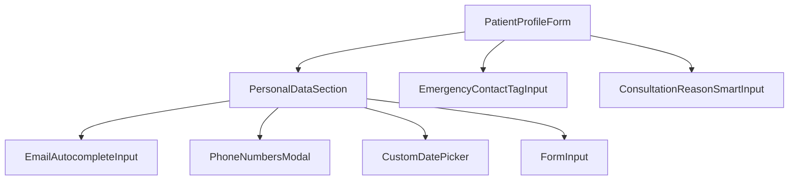
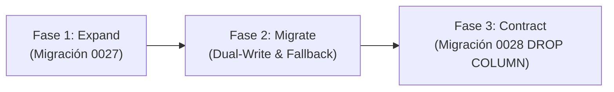

# Apartado 0004: Pacientes y Ficha del Paciente

Este documento detalla las especificaciones técnicas, decisiones arquitectónicas, esquema Drizzle ORM y acuerdos de diseño para el módulo de gestión de pacientes en **CuerpoHermoso Web** (`/dashboard/patients`), centrándose en el componente central **"Ficha del Paciente"** (`PatientProfileForm`) y sus capacidades de interacción avanzada.

---

## §1 Arquitectura del Componente: Ficha del Paciente (`PatientProfileForm`)

El componente **Ficha del Paciente** (`src/components/patients/PatientProfileForm.tsx`) constituye la interfaz primaria de captura y actualización clínica en el ecosistema. Opera en tres modalidades parametrizables:
1. `create`: Registro de nuevos pacientes desde el panel administrativo con persistencia de borrador local reactivo.
2. `doctor_edit`: Edición clínica completa por parte de especialistas y administradores.
3. `patient_self`: Autogestión del perfil del paciente con campos restringidos en solo lectura (ej. notas médicas y correo).

### §1.1 Estructura Modular de Subcomponentes



* **`PersonalDataSection` (`form-sections/PersonalData.tsx`):** Agrupa nombre, sexo biológico, documento de identidad, nacionalidad, fecha de nacimiento, teléfonos y correo electrónico.
* **`EmailAutocompleteInput` (`ui/EmailAutocompleteInput.tsx`):** Autocompletado multidispositivo sin dependencias de elementos HTML obsoletos.
* **`PhoneNumbersModal` (`patients/PhoneNumbersModal.tsx`):** Gestión modular de múltiples líneas telefónicas con bandera de número predeterminado.
* **`EmergencyContactTagInput` (`patients/EmergencyContactTagInput.tsx`):** Casilla autocontenida de etiquetas para contactos de emergencia en formato JSON.
* **`ConsultationReasonSmartInput` (`patients/ConsultationReasonSmartInput.tsx`):** Editor reactivo asistido por el diccionario clínico y completado rápido vía teclado (`Tab`).

---

## §2 Decisiones Arquitectónicas del Módulo

### Pacientes D-0001: Estructuración de Contacto de Emergencia en Formato JSON mediante Etiquetas

* **Contexto:** Anteriormente, el contacto de emergencia residía en una columna plana `text("emergency_contact")` donde se registraba información no normalizada (nombres sin teléfono o teléfonos sin parentesco).
* **Decisión Técnica:** 
  1. Se migra la columna a tipo JSON estructurado en PostgreSQL mediante Drizzle ORM:
     ```typescript
     // src/db/schema.ts
     emergencyContact: json("emergency_contact").$type<EmergencyContactItem[] | string>()
     ```
  2. La captura se realiza a través de un componente de etiquetas (`EmergencyContactTagInput`) dentro de la **misma casilla física**, evitando la proliferación de campos adicionales en el formulario.
  3. Permite ingresar múltiples contactos separándolos mediante comas (`,`) o tecla `Enter`.
  4. Extrae automáticamente números telefónicos (detección de patrones numéricos internacionales) y ofrece chips interactivos para sugerir parentescos frecuentes (`Mamá`, `Papá`, `Pareja`, `Hermano(a)`, `Hijo(a)`, `Amigo(a)`, etc.).
  5. Se mantiene retrocompatibilidad transparente con registros históricos en texto plano o JSON serializado.

```typescript
export interface EmergencyContactItem {
  name: string;
  phone?: string;
  relationship?: string;
}
```

---

### Pacientes D-0002: Almacenamiento Multi-Número Telefónico con Selección de Predeterminado

* **Contexto:** Los pacientes estéticos y quirúrgicos frecuentemente disponen de números alternativos (ej. teléfono laboral, línea extranjera, WhatsApp de recuperación postoperatoria). Limitar el esquema a una sola columna `phoneNumber` provocaba pérdida de datos de contacto vitales.
* **Decisión Técnica:**
  1. Se extiende el esquema de `Patient` añadiendo la columna JSON `phone_numbers`:
     ```typescript
     // src/db/schema.ts
     phoneNumber: text("phone_number"), // Número predeterminado activo
     phoneNumbers: json("phone_numbers").$type<PatientPhoneNumberItem[]>(), // Histórico y alternativas
     ```
  2. **Compatibilidad Absoluta:** La columna física `phone_number` se preserva como el número telefónico principal/predeterminado, garantizando que integraciones externas (Google Contacts, Meta WhatsApp API y listados) sigan operando sin refactorizaciones destructivas.
  3. **Disparador No Intrusivo:** En la misma línea de "Teléfono Móvil", en la esquina superior derecha, se incorpora un botón armonizado (`+ Adicionar otro`) que despliega el modal `PhoneNumbersModal`.
  4. **Selección de Predeterminado:** El modal ofrece un selector tipo checkbox/radio interactivo que designa cuál línea actúa como `isDefault: true`, sincronizándose inmediatamente con el input principal del formulario.

```typescript
export interface PatientPhoneNumberItem {
  number: string;
  isDefault?: boolean;
  label?: string; // 'Móvil' | 'WhatsApp' | 'Casa' | 'Trabajo' | 'Alternativo'
}
```

---

### Pacientes D-0003: Autocompletado Multidispositivo de Correo Electrónico Libre de Datalist

* **Contexto:** El uso convencional de `<input list="..." />` junto a `<datalist>` genera severas inconsistencias visuales y de usabilidad entre navegadores móviles (iOS Safari suele requerir doble toque y renderiza popovers nativos desalineados; Android Chrome exhibe problemas de tematización oscura).
* **Decisión Técnica:**
  1. Se crea el componente `EmailAutocompleteInput` implementado con listas flotantes accesibles (`role="listbox"`, `aria-autocomplete="list"`).
  2. **Regla de Activación (3 Caracteres):** Las sugerencias de proveedores se activan a partir del tercer carácter ingresado (ej. `car` sugiere `car@gmail.com`, `car@outlook.com`, `car@hotmail.com`).
  3. **Filtrado Inteligente de Dominio:** Si el usuario tipea el símbolo `@` seguido de letras (ej. `ana@g`), el componente restringe las opciones al proveedor coincidente (`ana@gmail.com`).
  4. **Navegación Fluida:** Soporta navegación por flechas de teclado (`ArrowDown`, `ArrowUp`), confirmación con `Tab` o `Enter`, y selección táctil directa para dispositivos móviles y tabletas.

---

### Pacientes D-0004: Autocompletado Clínico Inteligente con Atajo Tab en Motivo de Consulta

* **Contexto:** El campo inferior del formulario anteriormente se denominaba "Notas Médicas / Antecedentes", lo cual se solapaba conceptualmente con la pestaña de Historia Médica (`MedicalHistory`). Además, requería tipeo manual repetitivo de motivos comunes de consulta estética.
* **Decisión Técnica:**
  1. **Redefinición Semántica:** El campo se renombra prioritariamente a **"Motivo de Consulta"**, orientándolo a capturar el requerimiento estético/quirúrgico inicial del paciente.
  2. **Integración con Diccionario Clínico:** Se conecta con la acción de servidor `getClinicalDictionaryAction` y disparadores clínicos rápidos (`rino`, `mamo`, `lipo`, `blefaro`, `botox`, `acido`, `eval`, `control`, etc.).
  3. **Ghost Text Backdrop:** Utiliza una capa idéntica a la del Plan Quirúrgico que proyecta en tiempo real la continuación sugerida en gris/rosa detrás del cursor.
  4. **Atajo de Teclado `Tab ↹`:** Al presionar la tecla `Tab`, la sugerencia se incrusta atómicamente en el texto, respetando mayúsculas iniciales y offsets de cursor.
  5. **Accesibilidad Móvil:** Cuenta con un botón flotante y táctil de confirmación rápida para interfaces sin teclado físico.

```typescript
// Integración en src/components/patients/PatientProfileForm.tsx
<Controller
    control={control}
    name="medicalNotes"
    render={({ field }) => (
        <ConsultationReasonSmartInput
            value={field.value}
            onChange={field.onChange}
            isReadOnly={isPatientSelfMode}
            label="Motivo de Consulta"
            placeholder="Indique el motivo de consulta o requerimiento estético/médico del paciente..."
        />
    )}
/>
```

---

## §3 Esquema Drizzle ORM y Normalización de Datos

El esquema final para la tabla `Patient` en `src/db/schema.ts`:

```typescript
export const Patient = pgTable("Patient", {
  id: uuid("id").defaultRandom().primaryKey(),
  userId: uuid("user_id"),
  fullName: text("full_name").notNull(),
  gender: genderEnum("gender").default("female").notNull(),
  nationality: text("nationality"),
  documentId: text("document_id"),
  birthDate: date("birth_date"),
  phoneNumber: text("phone_number"),
  phoneNumbers: json("phone_numbers").$type<PatientPhoneNumberItem[]>(),
  address: text("address"),
  email: text("email").unique(),
  occupation: text("occupation"),
  emergencyContact: json("emergency_contact").$type<EmergencyContactItem[] | string>(),
  medicalNotes: text("medical_notes"),
  role: text("role", { enum: rolesEnum }).default("user").notNull(),
  accessLevel: integer("access_level").default(0).notNull(),
  googleContactId: text("google_contact_id"),
  createdAt: timestamp("created_at").defaultNow().notNull(),
  updatedAt: timestamp("updated_at").defaultNow().$onUpdate(() => new Date()),
});
```

---

## §4 Estrategia de Despliegue Seguro (Zero-Downtime: Expand & Contract)

Para salvaguardar la disponibilidad en producción y mitigar cualquier riesgo de pérdida de información o inconsistencia en caliente, la transición de `phone_number` (texto simple) hacia `phone_numbers` (JSON estructurado) implementa estrictamente el patrón **Expand and Contract (Parallel Run)** en tres fases secuenciales:



### §4.1 Fase 1: Despliegue de Migración con Convivencia y Poblado (0027)

* Se evita deliberadamente eliminar la columna vieja `phone_number` en este despliegue.
* Ambas columnas conviven físicamente en la tabla `Patient`.
* La migración `0027_bright_tusk.sql` crea la columna `phone_numbers` y ejecuta un script de *backfill* atómico que puebla la nueva estructura a partir de los datos existentes:

```sql
-- drizzle/0027_bright_tusk.sql
ALTER TABLE "Patient" ADD COLUMN IF NOT EXISTS "phone_numbers" json;--> statement-breakpoint

-- Poblado inicial seguro de phone_numbers desde el respaldo phone_number
UPDATE "Patient"
SET "phone_numbers" = json_build_array(
  json_build_object(
    'number', "phone_number",
    'isDefault', true,
    'label', 'Móvil'
  )
)
WHERE "phone_number" IS NOT NULL
  AND ("phone_numbers" IS NULL OR "phone_numbers"::text = '[]' OR "phone_numbers"::text = 'null');
```

### §4.2 Fase 2: Actualización de Código (Lectura y Escritura en `phoneNumbers`)

* **Lectura:** La aplicación consulta prioritariamente la nueva estructura `phoneNumbers` (extrayendo el elemento marcado como `isDefault: true` mediante el helper centralizado `getPrimaryPhoneNumber`). Si por alguna razón el registro no tiene datos en el JSON, aplica un **fallback transparente** hacia la columna de respaldo `phone_number`.
* **Escritura:** La aplicación escribe y actualiza como fuente primaria de verdad en `phoneNumbers`. Adicionalmente, mantiene un *dual-write* hacia `phone_number` para garantizar que procesos heredados, consultas externas o réplicas se mantengan sincronizados sin divergencias.

```typescript
// src/lib/validations/patient.ts
export function getPrimaryPhoneNumber(patient?: {
  phoneNumbers?: PatientPhoneNumberItem[] | null;
  phoneNumber?: string | null;
} | null): string {
  if (!patient) return "";

  // 1. Prioridad absoluta: Lectura de phoneNumbers
  if (Array.isArray(patient.phoneNumbers) && patient.phoneNumbers.length > 0) {
    const defaultItem = patient.phoneNumbers.find((p) => p.isDefault && p.number?.trim());
    if (defaultItem?.number) return defaultItem.number.trim();
    const firstValid = patient.phoneNumbers.find((p) => p.number?.trim());
    if (firstValid?.number) return firstValid.number.trim();
  }

  // 2. Fallback de contingencia: phoneNumber antiguo
  return patient.phoneNumber?.trim() || "";
}
```

### §4.3 Fase 3: Limpieza y Eliminación Definitiva (Contrato Futuro - Migración 0028)

* Una vez desplegada la Fase 1 y 2 en el entorno de producción, se ejecuta un periodo de observación y verificación para confirmar que el 100% de los registros disponen de sus teléfonos correctamente mapeados en el JSON.
* Cumplida la validación en producción, se procederá a:
  1. Retirar la definición `phoneNumber: text("phone_number")` en `src/db/schema.ts`.
  2. Generar y ejecutar la migración **0028** con la instrucción `ALTER TABLE "Patient" DROP COLUMN "phone_number";`.
  3. Remover el fallback hacia `phoneNumber` en el helper de lectura.

---

## §5 Relación con Otros Módulos

* **Módulo de Finanzas:** [`content/docs/guides/module_0001_finances.mdx`](./module_0001_finances.mdx) (El paciente actúa como pagador y titular de planes de pago).
* **Módulo de Servicios:** [`content/docs/guides/module_0003_services.mdx`](./module_0003_services.mdx) (El motivo de consulta orienta la cotización y agendamiento de servicios quirúrgicos y ambulatorios).
* **Módulo de Fotografías:** [`content/docs/guides/module_0002-photos.mdx`](./module_0002-photos.mdx) (La ficha del paciente centraliza la galería de evolución fotográfica y consentimiento informado).
